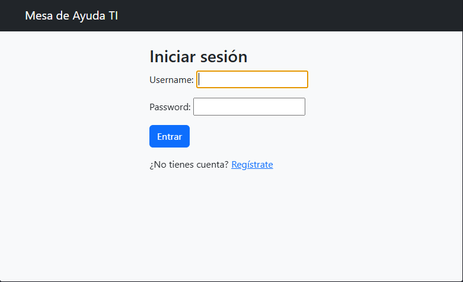
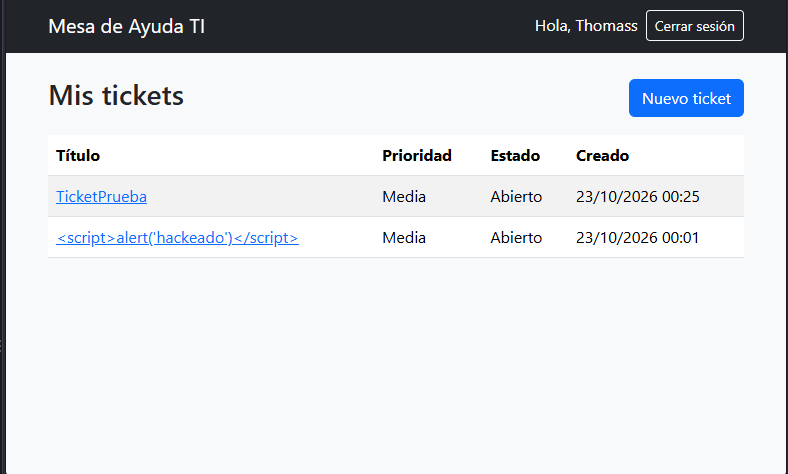
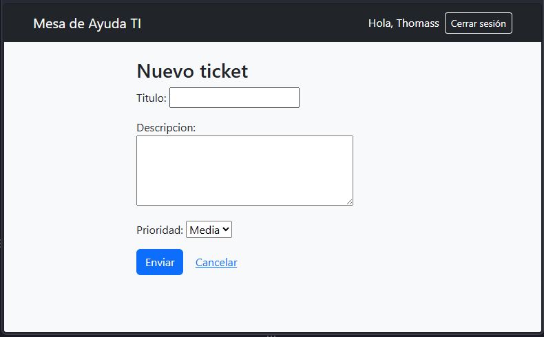
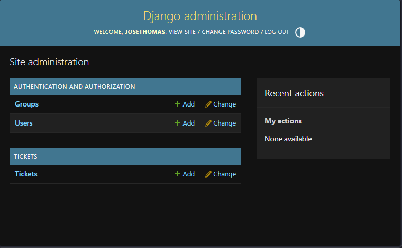

# Mesa de Ayuda TI

Aplicación web de gestión de tickets de soporte técnico, desarrollada con Django. Los usuarios se registran, reportan problemas y revisan el estado de sus solicitudes; el administrador gestiona todos los tickets desde un panel.

Proyecto de portafolio realizado como parte de mi formación en Ingeniería en Informática (INACAP), con foco en buenas prácticas de seguridad web.

## Capturas

## Funcionalidades

- Registro, inicio y cierre de sesión de usuarios.
- Creación de tickets con título, descripción y prioridad (baja, media, alta).
- Listado y detalle de los tickets propios.
- Estados de ticket: abierto, en proceso y cerrado.
- Panel de administración para gestionar todos los tickets (filtros y búsqueda).

## Tecnologías

- Python 3.13 y Django 6.1
- SQLite
- HTML y Bootstrap 5
- python-dotenv para la configuración

## Medidas de seguridad

- **Autenticación:** sistema de usuarios de Django, con contraseñas almacenadas con hash y validación de contraseñas débiles.
- **Control de acceso:** las vistas requieren sesión iniciada y cada usuario solo puede ver sus propios tickets. Intentar abrir el ticket de otra persona cambiando la dirección devuelve 404 (previene IDOR).
- **CSRF:** todos los formularios incluyen token de protección.
- **XSS:** las plantillas escapan el contenido de forma automática.
- **Inyección SQL:** todas las consultas usan el ORM de Django.
- **Secretos fuera del código:** la clave secreta y la configuración sensible se leen desde un archivo `.env` que no se sube al repositorio.
- **Configuración para producción:** cookies seguras, redirección a HTTPS y HSTS cuando `DEBUG` está desactivado. Revisado con `python manage.py check --deploy`.

## Cómo ejecutarlo (Windows)

1. Descarga el proyecto y entra a la carpeta:

        git clone https://github.com/jose-munoz-aguilera/mesa-ayuda-ti.git
        cd mesa-ayuda-ti

2. Crea y activa el entorno virtual, e instala las dependencias:

        python -m venv venv
        venv\Scripts\activate
        pip install -r requirements.txt

3. Crea tu archivo de configuración:

        copy .env.example .env

4. Genera una clave secreta y pégala en `.env`, en `DJANGO_SECRET_KEY`:

        python -c "from django.core.management.utils import get_random_secret_key as g; print(g())"

5. Crea la base de datos, un administrador y enciende el servidor:

        python manage.py migrate
        python manage.py createsuperuser
        python manage.py runserver

6. Abre http://127.0.0.1:8000 en el navegador.

## Mejoras pendientes

- Permitir cambiar el estado del ticket desde el sitio (hoy se hace en el panel de administración).
- Comentarios y respuestas dentro de cada ticket.
- Pruebas automatizadas.
- Publicar la aplicación con una base de datos de producción.

## Autor

José Thomas Muñoz Aguilera, estudiante de Ingeniería en Informática, INACAP Curicó.
[LinkedIn](https://www.linkedin.com/in/jose-munoz-aguilera)